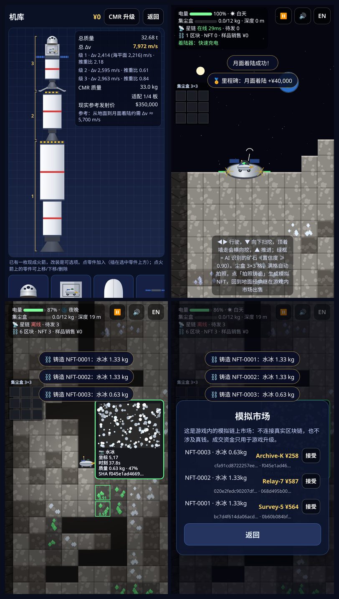

# 月球挖矿 Moon Miner · 星链挖矿版 🚀🌕⛏️

> 用一枚现成的胶囊飞船飞到月球（机库改装是可选项），软着陆后驾驶圆形扁平的 CMR 扫地机式着陆器扫月壤。尘盒分成 3×3 格，每格拍一张照片并生成模拟 NFT，挂到游戏内市场出售，赚钱解锁更好的零件。链上市场是模拟的，不连接真实区块链，也不涉及真钱。
> Fly a ready-made capsule spacecraft to the Moon (hangar building is optional). After a soft landing, drive the round, flat CMR vacuum-style lander to sweep regolith. The dust box is a 3×3 grid; each compartment is photographed and minted as a simulated NFT, then listed on the in-game market to fund upgrades. The market is simulated: there is no real blockchain and no real money.

**▶ 在线试玩 / Play now: <https://yydemo.github.io/moon-miner/>**（手机优先，电脑也能玩 / mobile-first, desktop works too）



## 设计依据 / Design basis

- 游戏的故事、资源、机器人参数、经济和阶段，按 [yydemo/star-chain-earn-mine](https://github.com/yydemo/star-chain-earn-mine) 的实际内容设计。每一项对应哪个源文件，见 [docs/DESIGN_MAPPING.md](docs/DESIGN_MAPPING.md)。
  The story, resources, rover parameters, economy and stages follow the actual contents of [yydemo/star-chain-earn-mine](https://github.com/yydemo/star-chain-earn-mine). [docs/DESIGN_MAPPING.md](docs/DESIGN_MAPPING.md) lists the source file behind each choice.
- 玩法参考 2D 火箭模拟器类游戏：零件拼装、分级、轨道、地图、时间加速。
  The gameplay is in the style of 2D rocket simulators: part-based building, staging, orbits, a map view and time warp.
- **代码和画面全部原创**：没有使用、反编译或引用任何其他游戏的代码或素材。所有图形都由 Canvas 代码绘制，音效由 WebAudio 合成。
  **All code and art are original.** No code or assets from any other game were used, decompiled or referenced. All graphics are drawn by Canvas code and all sounds are synthesised with WebAudio.
- 已做匿名化：游戏和文档里不出现真实机构名称、人名、专利号或软著号。
  Anonymised: the game and docs contain no real institution names, personal names, or patent / software-copyright numbers.

## 功能 / Features

### 火箭组装 / Rocket builder
- 飞船是胶囊外形（载人/货运返回舱），火箭只是运载工具。默认提供一枚能登月的现成火箭，机库改装是可选项。
  The spacecraft is a crew/cargo capsule; the rocket is just the ride. A ready-made Moon-capable stack is the default; hangar building is optional.
- 零件拼装：返回舱、CMR 载荷舱、整流罩、太阳能板、着陆腿、5 种储箱、6 种发动机、分离器。
  Part-based builder: capsule, CMR payload bay, fairing, solar panel, landing legs, 5 tank sizes, 6 engines and decouplers.
- 实时显示每级的质量、推力、海平面/真空 Δv 和起飞 TWR，并给出约 5,700 m/s 的登月 Δv 参考。
  Live readout of each stage's mass, thrust, sea-level/vacuum Δv and lift-off TWR, against a reference of about 5,700 m/s to land on the Moon.
- 显示 CMR 质量、能否放进 1/4 搭载位，以及按真实报价估算的发射费用。
  Shows the CMR's mass, whether it fits a 1/4 rideshare plate, and a launch cost estimated from real quotes.
- 自带一枚能登月的默认火箭。
  Ships with a default rocket that can reach the Moon.

### 飞行 / Flight
- 二维轨道物理，1:10 缩小的地月系统（地球和月球的表面重力是真实的），带大气阻力。
  2D orbital physics in a 1:10 Earth–Moon system (surface gravity is real), with atmospheric drag.
- 圆锥曲线拼接：进入和离开月球引力范围（SOI）时自动切换参考天体。
  Patched conics: the reference body switches automatically when you enter or leave the Moon's sphere of influence (SOI).
- 多级分离；推力为 0 时可按开普勒轨道快速推进；时间加速最高 ×100000。
  Multi-stage separation, Kepler "on-rails" propagation while coasting, and time warp up to ×100000.
- 地图视图：显示远地点/近地点（Ap/Pe）、月球轨道、SOI、预测轨迹、相遇时的月球位置和撞击点。
  Map view with Ap/Pe, the Moon's orbit, its SOI, the predicted trajectory, the Moon's position at encounter and the impact point.
- 自动驾驶辅助：入轨 → 地月转移 → 滑行 → 月球捕获 → 离轨 → 动力下降 → 着陆。
  Autopilot assist: ascent → trans-lunar injection → coast → lunar capture → deorbit → powered descent → landing.
- SAS 姿态模式：保持、顺行、逆行。
  SAS attitude modes: hold, prograde, retrograde.

### 月面采矿 / Lunar mining
- 着陆器做成圆形扁平的扫地机模样（原创造型，没有商标）。
  The lander is shaped like a round, flat robot vacuum (original art, no trademarks).
- CMR 机器人的电池、太阳能（昼夜循环）、12 kg 集尘盒，以及 AI 识别（置信度 ≥ 0.90），参数取自源仓库。
  The CMR rover's battery, solar power (with a day/night cycle), 12 kg dust box and AI classification (confidence ≥ 0.90) use the source repo's parameters.
- 5 种材料：稀土、金属、硅酸盐、水冰、有机物，价格取自源仓库。
  5 materials (rare earth, metallic, silicate, water ice, organic), priced from the source repo.
- 尘盒分成 3×3 格。每格拍一张带坐标、时刻、质量、成分和哈希的照片，再生成模拟 NFT（编号来自照片与元数据的 SHA-256），挂到游戏内市场，由模拟买家出价。
  The dust box is a 3×3 grid. Each compartment gets a photo card (site, time, mass, composition, hash) and is minted as a simulated NFT (token id from SHA-256 of the photo and metadata), then listed on the in-game market where simulated buyers bid.
- 只有中继卫星在线、机器人回到月面时才能成交。账本仍使用 SHA-256 简化工作量证明。市场是模拟的，不连接真实区块链，也不涉及真钱。
  Sales settle only while a relay satellite is online and the rover is back on the surface. The ledger still uses SHA-256 "PoW-lite". The market is simulated: no real blockchain and no real money.
- 结算页会校验账本完整性。
  The results screen verifies ledger integrity.
- 用里程碑奖金和销售收入升级 CMR，或解锁更大的储箱、发动机和着陆腿。
  Spend milestone bonuses and sales income on CMR upgrades, or unlock bigger tanks, engines and landing legs.

### 通用 / General
- 中英双语界面：右上角「EN / 中」切换。
  Bilingual Chinese / English UI: tap "EN / 中" at the top right to switch.
- PWA：可以添加到主屏幕，离线也能玩。
  PWA: add it to the home screen and play offline.
- 存档会自动从旧版迁移。
  Saves migrate automatically from the old version.
- 不需要构建，也不依赖外部库。
  No build step and no external libraries.

## 操作 / Controls

| 功能 / Action | 触屏 / Touch | 键盘 / Keyboard |
|---|---|---|
| 左转 / 右转 · Rotate | 左转 / 右转按钮 · rotate buttons | A / D，← / → |
| 油门 · Throttle | 右侧滑条、「满」/「关」 · slider, Full / Cut | W / S 增减 · up / down，Z 满 · full，X 关 · cut |
| 分级 / 点火 · Stage / ignite | 「分级」大按钮 · big STAGE button | 空格 / 回车 · Space / Enter |
| 地图 · Map | 「地图」 · Map | M |
| 时间加速 · Time warp | ⏪ / ⏩ | `,` / `.` |
| SAS 姿态 · SAS mode | 「保持」按钮循环 · cycles Hold | T |
| 自动驾驶 · Autopilot | 「自动驾驶」 · Autopilot | — |
| 缩放 · Zoom | 双指捏合 · pinch | 鼠标滚轮 · mouse wheel |
| 采矿 · Mine | 方向按钮，按住「下」向下挖 · arrow buttons, hold ↓ to dig down | 方向键 / WASD · arrow keys / WASD |
| 拍照铸造 · Photo & mint | 「拍照铸造」/「模拟市场」 · Photo & mint / Market | E |
| 暂停 / 静音 · Pause / Mute | 右上角按钮 · top-right buttons | P 或 Esc · P or Esc / N |

## 玩法流程 / How to play

1. **出发 / Launch**：默认已装好一枚现成火箭。想改装就在机库里点零件（插到选中零件上方），看 Δv 和 TWR，确认没有报错后点「发射」。
   A ready-made rocket is already loaded. To rebuild, tap parts in the hangar (inserted above the selected one), check Δv and TWR, then tap **Launch**.
2. **入轨 / Orbit**：按「分级」点火，转向东飞出大气层，把轨道抬到约 52 km（真实的 525 km 太阳同步轨道 ÷ 10）。
   Press **STAGE** to ignite, pitch east out of the atmosphere and raise the orbit to about 52 km (the real 525 km sun-synchronous orbit ÷ 10).
3. **奔月 / To the Moon**：在相位窗口顺行加速，直到地图上出现月球相遇点，然后时间加速滑行。
   Burn prograde in the phase window until the map shows a Moon encounter, then time-warp through the coast.
4. **着陆 / Land**：在近月点逆行减速，然后动力下降。触地速度要小于着陆腿的承受值，并且保持竖直。
   Burn retrograde at periapsis, then make a powered descent. Touch down slower than your legs can take, and keep upright.
5. **采矿 / Mine**：点「部署 CMR」。扫挖月壤，看好电量（夜间太阳能很弱）。尘盒每格拍一张照片，点「拍照铸造」生成模拟 NFT，回到月面后在模拟市场卖掉。
   Tap **Deploy CMR**. Sweep and dig, and watch your battery (solar is weak at night). Each dust-box cell is photographed; tap **Photo & mint** to create a simulated NFT, then sell it on the in-game market once you are back on the surface.
6. **升级 / Upgrade**：用资金升级 CMR，或解锁更强的零件。
   Spend your funds on CMR upgrades or stronger parts.

## 文件 / Files

| 文件 / File | 内容 / Contents |
|---|---|
| `index.html` | 界面与样式 · UI markup and styles |
| `js/data.js` | 零件、天体、材料、机器人、里程碑数据（带来源注释） · parts, bodies, materials, rover and milestone data with source notes |
| `js/i18n.js` | 中英文本 · zh/en strings |
| `js/core.js` | 存档与迁移、输入、音效、通用绘图 · saves and migration, input, audio, shared drawing |
| `js/orbit.js` | 轨道根数、开普勒求解、轨迹预测 · orbital elements, Kepler solver, trajectory prediction |
| `js/vessel.js` | 分级与 Δv 计算、零件绘制 · staging and Δv maths, part art |
| `js/flight.js` | 飞行物理、自动驾驶、飞行视图与地图 · flight physics, autopilot, flight and map views |
| `js/mining.js` | 月面采矿、尘盒格子、模拟 NFT 市场、中继、账本 · lunar mining, dust-box grid, simulated NFT market, relay, ledger |
| `js/builder.js` | 机库与 CMR 商店 · hangar and CMR shop |
| `js/main.js` | 主循环、HUD、界面流程 · main loop, HUD, screen flow |
| `sw.js` | 离线缓存 · offline cache |

## 本地运行 / Run locally

```bash
python3 -m http.server 8000   # 打开 / open http://localhost:8000/
```

## 说明 / Notes

- 世界按 1:10 缩小，方便在手机上玩；采矿收益里有一个 ×10 的“太空稀缺溢价”，这是游戏假设，不是源仓库的数据。
  The world is scaled 1:10 so it plays well on phones. Mining income includes a ×10 "space scarcity premium", which is a game assumption and not source-repo data.
- 源仓库里的火星任务、样品返回和小行星内容暂未做进游戏。
  The source repo's Mars mission, sample return and asteroid content are not in the game yet.
